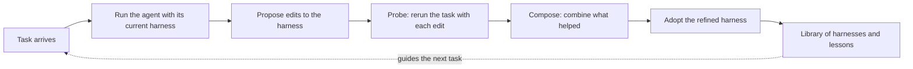

<h3 align="center">
  harness2-claude-port<br>
  A Claude Code executor for Harness²
</h3>

<p align="center">
  <a href="https://arxiv.org/pdf/2610.14224"></a>
  <a href="docs/BENCHMARKS.md"></a>
  <a href="LICENSE"></a>
</p>

<p align="center">
  <em>An independent port of <a href="https://github.com/google-research/harness2">Harness²</a>, not from the original authors.</em>
</p>


A **harness** is the system around a model that enables it to act as an agent:
prompts, tools, memory, skills, orchestration, and more. **Harnessing** is the
process of optimizing that system.

[Harness²](https://github.com/google-research/harness2) is Google Research's
framework for **recursive agent harnessing** in an open world
([paper](https://arxiv.org/abs/2610.14224)). It connects two levels of
recursion while keeping model weights fixed:

* **Task-level recursion** refines the execution harness for the current task
  through a contrastive **Propose-Probe-Compose** step: propose edits, probe
  their effects on the same task, and compose a refined harness from behavioral
  contrasts between executions, without ground-truth feedback.
* **Harnessing-level recursion** updates a persistent *improvement harness*
  with adopted harnesses and evidence-supported lessons from each task to guide
  future refinement.

This repository is an **independent port** that lets Harness² improve
[Claude Code](https://github.com/anthropics/claude-code) agents, alongside
upstream's OpenCode and Codex executors. It is not a Google project and is not
endorsed by the Harness² authors. A sibling port does the same for
Hermes Agent at [harness2-hermes-port](https://github.com/abhaymettu/harness2-hermes-port).

## Status

This port tracks upstream `main` at
[`6868817`](https://github.com/google-research/harness2/commit/6868817518876de8fd170c6a8354daca273b6191)
(2026-11-02), including upstream's fix that keeps API keys and host tokens out of
agent subprocesses. Upstream ships OpenCode and Codex executors and a `claude_cli`
improver channel that reaches Claude through Vertex AI only; it has no Claude Code
executor yet. Community pull requests propose one
([#66](https://github.com/google-research/harness2/pull/66),
[#177](https://github.com/google-research/harness2/pull/177)), and
[#64](https://github.com/google-research/harness2/issues/64) asks for it. If upstream
merges a Claude Code executor, this section will point there and this port will stop
being needed.

## Contents

- [Status](#status)
- [The idea in plain terms](#the-idea-in-plain-terms)
- [How one task goes](#how-one-task-goes)
- [Quick start](#quick-start)
- [Your own tasks](#your-own-tasks)
- [Experiments](#experiments)
- [What Claude Code brings](#what-claude-code-brings)
- [Keeping the scores honest](#keeping-the-scores-honest)
- [What to expect](#what-to-expect)
- [Going further](#going-further)
- [Citation](#citation)
- [Contributing](#contributing)
- [License](#license)
- [Disclaimer](#disclaimer)

## The idea in plain terms

Most ways of making an AI agent better change the model itself, by training it
on more data. Harness² leaves the model alone and improves everything around
it instead: the instructions it starts with, the notes it can consult, the
small tools and scripts it is handed, and the helpers it can delegate to.

Think of a capable new hire. You cannot change how smart they are, but you can
give them a better briefing, a better checklist and better tools. Harness²
does that automatically, one task at a time, and keeps a record of what helped
so the next task starts from a better place.

The unusual part is that it does this **without an answer key**. It never
looks at the correct answer to a task. It learns by comparing: it runs the
same task with slightly different setups, looks at how the agent behaved
differently in each, and keeps the changes that look like they helped.

## How one task goes



1. **Run.** The agent attempts the task with its current harness.
2. **Propose.** A second model, the improver, reads what happened and suggests
   edits: a clearer instruction, a new checklist item, a helper script.
3. **Probe.** Each suggested edit is tried on the same task, so the runs can
   be compared side by side.
4. **Compose.** The improver looks at how behavior differed between the runs
   and builds one refined harness from the edits that made a difference.
5. **Remember.** The adopted harness and a short written lesson go into a
   library, which the improver consults on later tasks.

Steps 2 to 4 are the task-level recursion from the paper. Step 5 is the
harnessing-level recursion: the system gets better at improving itself, not
just at the task in front of it.

## Quick start

Use Python 3.12 or 3.13 and [uv](https://docs.astral.sh/uv/). The offline demo needs
no model credentials:

```bash
uv venv --python 3.12 .venv
source .venv/bin/activate
uv pip install -e '.[render]'
harness2-demo --output runs/demo --k 2
```

The Claude Code executor needs the `claude` CLI and a Claude Code login (a
subscription or an API key). Copy the settings template, then check that every
harness part reaches a session and run two small tasks:

```bash
cp .env.example .env
export HARNESS2_CLAUDE_MODEL=claude-haiku-5-5
harness2-check --substrate cc --conformance
harness2 --bench local --substrate cc --k 1 --only-domains data-cleaning --max-tasks 2
harness2-judge --bench local --substrate cc --k 1
```

The [quick start](docs/QUICKSTART.md) explains each step and every setting.

## Your own tasks

`--bench local` runs on any folder of tasks, not only the 12 shipped in
`localbench/tasks/`. Point `HARNESS2_LOCALBENCH_TASKS` at a folder with one
directory per task:

```text
my-tasks/
  fix-the-parser/
    task.json      {"domain": "fix-the-parser", "work": "fix a parsing bug", "timeout": 900}
    prompt.md      the task as the agent sees it; deliverables go under output/
    files/         the agent's starting folder
    grader/grade.py   prints {"n_passed", "n_criteria", "checks"}; never shown to the agent
```

A task in a domain the port does not ship names its own one-line `work` description.
If the answer to a task also lives somewhere else on the machine, such as the
repository the task was cut from, list those paths in `HARNESS2_LOCALBENCH_SEAL`
(separated by `:`) and no session can read them.

## Experiments

There are two ways to spend more effort on a task. **Parallel recursion**
tries several candidate harnesses at once and composes a refinement from all
of their evidence. **Sequential recursion** takes the refined harness and runs
Propose-Probe-Compose on it again, several times in a row. The
[experiment guide](docs/EXPERIMENTS.md) covers both, plus task selection,
reproducibility and baselines. The upstream benchmarks (JobBench, LAB,
WorkBuddy-Bench) are described in the [benchmark guides](docs/BENCHMARKS.md);
that code is unchanged here and was not rerun for this port.

## What Claude Code brings

Harness² describes a harness as eight editable parts: **system prompt,
guardrails, memory, tool guidance, subagents, skills, scripts and plugins**.
Claude Code already has a native home for every one of them, so an improved
harness is just a folder Claude Code knows how to read:

| Part of the harness | Where it lives in Claude Code |
|---|---|
| System prompt | An extra system prompt file added to the session |
| Guardrails, memory, tool guidance | The project's `CLAUDE.md` |
| Skills | `.claude/skills/`, one folder per skill |
| Scripts | `scripts/` |
| Subagents | `.claude/agents/`, one file per helper agent |
| Plugins | Hooks in `.claude/settings.json` |

Each attempt runs as a fresh, headless Claude Code session built from that
folder. Because the harness is made of ordinary Claude Code files, an adopted
harness is something a person can open, read and reuse by hand.

## Keeping the scores honest

An agent that edits its own setup could, in principle, edit its way around
the test. The port puts four guards in place:

* **A fixed floor.** Every session starts from settings that no harness edit
  can reach. Your personal `CLAUDE.md`, saved memories and other user settings
  never leak into a run, and tools whose effects would outlive the session,
  such as schedules and notifications, are switched off.
* **No host secrets.** Rollouts and improver sessions start from your
  environment minus upstream's list of runner and host credentials (judge and
  bridge keys, GitHub, AWS, OpenAI, Google and Slack tokens) and minus every
  other variable named like a credential (`NPM_TOKEN`, `HF_TOKEN`,
  `DB_PASSWORD`). Only Claude Code's own login passes through.
* **Hidden checkers.** On macOS, the operating system's sandbox stops every
  session from reading the scoring scripts, the run history and other runs'
  results, including any route through another process.
* **A clean history.** Before publishing, a pre-flight check scans the whole
  git history for secrets and private paths.

Agents in these runs can still use the internet, and some public benchmark
rubrics are online, so a strictly clean evaluation needs
[network restrictions](docs/EXPERIMENTS.md#web-access).

## What has been measured

On this sync, the component probe passes 8 of 8 with the floor held
(`harness2-check --substrate cc --conformance`, Claude Haiku 5.5), and the
test suite passes. Earlier sweeps on the 12 localbench tasks ran end to end,
but the base harness already scored 100% on every task, so those runs show
the machinery works and cannot show a gain. Measuring a gain needs tasks the
base harness only partly solves; the `HARNESS2_LOCALBENCH_TASKS` folder
above is the way in. [VALIDATION.md](VALIDATION.md) lists every command and
its output.

## Going further

* [Quick start](docs/QUICKSTART.md): install, run the offline demo, and try
  the Claude Code executor.
* [Setup guide](docs/SETUP.md): requirements, credentials and the upstream
  benchmarks.
* [Experiment guide](docs/EXPERIMENTS.md): recursion modes, cost, results and
  resuming a run.
* [Upstream changes](UPSTREAM.md): every upstream file this port modifies, and
  why.

## Citation

Cite the Harness² paper:

```bibtex
@article{xu2026harness2,
  title   = {Harness$^2$: Recursive Agent Harnessing for an Open World},
  author  = {Xu, Ruiyao and Chen, Yanfei and CuiZhu, Zhongying and Dalvi Mishra, Bhavana and Ming, Yifei and Yu, Han and Han, Rujun and Lee, Chen-Yu and Pfister, Tomas},
  eprint  = {2610.14224},
  archivePrefix = {arXiv},
  year    = {2026},
  url     = {https://arxiv.org/abs/2610.14224}
}
```

## Contributing

See [CONTRIBUTING.md](CONTRIBUTING.md). Coding agents should read
[AGENTS.md](AGENTS.md) first.

## License

Apache 2.0, the same license as upstream; see [LICENSE](LICENSE) and
[NOTICE](NOTICE). Code under [`third_party/`](third_party/README.md),
benchmarks and datasets keep their own licenses; see the
[third-party notices](dependencies/README.md). The Harness² logo, wordmark,
figures and video are not included. Modified by The harness2-ports Authors:
this README replaces the upstream one, which is in the
[upstream repository](https://github.com/google-research/harness2).

## Disclaimer

This is an independent port, not an officially supported Google product, and it
is not endorsed by the Harness² authors.
